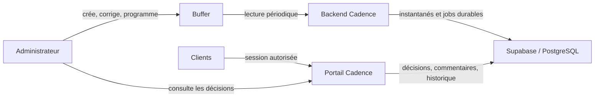

# Architecture Cadence

Référence : récupération du 11 octobre 2026, base `09cdeb1`, branche de nettoyage initiale. La branche de travail courante est `chore/cadence-consolidation-2026-10-11`, consolidée sans changement applicatif depuis `c0af3a0`. Voir [PROJECT_STATUS.md](PROJECT_STATUS.md) pour les preuves et [CLEANUP_REPORT.md](CLEANUP_REPORT.md) pour les autres versions.

## Architecture constatée et architecture cible

| Élément | Constat sur la base récupérée | Cible minimale | Décision |
| --- | --- | --- | --- |
| Next.js / React | Pages serveur, composants client, actions, endpoints, instrumentation | Un même backend et portail | CONSERVER |
| Content Studio | Éditeur et bibliothèque retirés de cette branche ; moteur, schéma et tests historiques encore présents | Aucune création interne | SUPPRIMER progressivement les dépendances exclusives restantes |
| Calendrier | Consultation, filtres, mois/semaine ; déplacement retiré | Lecture seule admin et client | CONSERVER |
| Supabase | Auth, PostgreSQL/RLS, Storage ; actuellement services auto-hébergés en production | Même responsabilité ; éviter une migration d'hébergement pendant le nettoyage | CONSERVER |
| Buffer | Adaptateur GraphQL, routeur multi-comptes, lecture et écritures optionnelles | Source de contenu et publication ; lecture seulement depuis Cadence au MVP | SIMPLIFIER sans retirer l'isolation |
| Jobs | Verrous/baux SQL, état durable, boucle urgente, déclenchement HTTP/cron optionnel | Un planificateur léger, jobs idempotents dans PostgreSQL | RÉUTILISER |
| n8n | Instance VPS indépendante ; deux templates dans le dépôt | Hors du parcours critique | CONSERVER l'instance, RETIRER progressivement la dépendance applicative éventuelle |
| Notifications | File SQL, simulation par défaut, webhook possible | Notifications internes ; e-mail facultatif plus tard | SIMPLIFIER |
| Docker / proxy | Image Next autonome, Supabase auto-hébergé, passerelle, Caddy existant | Réutiliser l'exploitation existante après validation | CONSERVER sans intervention pendant cette mission |

Ce diagramme représente la **cible**. Le moteur historique de programmation automatique existe encore dans le backend récupéré et ne doit pas être activé pour le MVP manuel.

Point métier à trancher avant la transition : la date entre actuellement dans l’empreinte validée. Programmer après l’accord un brouillon auparavant sans date ajouterait une date et pourrait invalider cet accord au passage suivant. Définir si l’accord porte sur le contenu seul ou aussi sur une date proposée, puis tester cette règle explicitement ; une simple désactivation des écritures ne suffit pas. Si la date fait partie de l’engagement validé, un changement doit être resoumis.

Buffer est la source du texte, des médias, des dates et du statut externe. Cadence est la source des versions observées, commentaires et décisions locales. Le client approuve une empreinte/version précise ; une modification du contenu ou de la date invalide l'accord. Les instantanés et l'historique persistent dans PostgreSQL après une panne du VPS ; la disponibilité des médias externes n'est pas garantie par cet historique.

## Organisation à préserver

- `src/server/auth.ts`, `src/proxy.ts`, `src/server/supabase/` : session et accès.
- `src/server/client-space.ts`, `workspace.ts`, `data.ts` : lectures filtrées, diagnostics techniques masqués aux clients.
- `src/server/post-versions.ts` : historique partagé indépendant du Studio.
- `src/server/actions.ts` et fonctions SQL : validations et commentaires, gestion client ; programmation encore couplée à l'approbation.
- `src/server/publishing/buffer-provider.ts`, `router.ts`, `connections.ts`, `credentials.ts` : adaptation, association compte/canal, état durable et chiffrement. Ces responsabilités restent distinctes et utiles.
- `src/server/sync.ts`, `urgent.ts`, `notifications.ts` et migrations : reprise, verrous, erreurs, files persistantes.
- `src/components/publications/`, `calendar/`, `shared/` : aperçus, médias, décisions, échanges.

Ne pas remplacer les contrôles SQL par de simples filtres d'interface. Ne pas supprimer les RLS, jetons de réservation ou protections contre les réponses tardives sous prétexte de simplifier.

## Buffer : limites documentées et limites locales

La [documentation d'authentification Buffer](https://developers.buffer.com/guides/authentication.html) distingue clés personnelles et OAuth. Les clés personnelles sont des secrets serveur ; le cloisonnement client doit être imposé dans Cadence, pas supposé à partir d'une clé. La rotation doit vérifier l'identité distante avant remplacement.

Le schéma officiel [EditPostInput](https://developers.buffer.com/types/EditPostInput.html) expose l'édition d'un post existant par `id`, `saveToDraft`, `mode`, `dueAt`, texte et médias. [ShareMode](https://developers.buffer.com/types/ShareMode.html) et le [guide de programmation](https://developers.buffer.com/guides/posts-and-scheduling.html) documentent les modes de programmation. La compatibilité effective de chaque réseau, droits, forfait et type de média reste **NON VÉRIFIÉE sur des comptes réels pendant cette mission**. Aucune mutation Buffer n'a été déclenchée.

| Option | Fiabilité et exploitation | Complexité / sécurité | Avis |
| --- | --- | --- | --- |
| A : décision locale, programmation humaine dans Buffer | Fonctionne malgré une indisponibilité temporaire du job ; demande un contrôle humain de la dernière version | Pas de clé d'écriture nécessaire ; risque d'erreur de procédure | MVP recommandé, après découplage métier/SQL |
| B : programmation après approbation | Exige relecture, réservation, reprise après réponse perdue et compensation | Plus de courses, droits d'écriture et maintenance ; moteur existant à conserver en attente | Phase future séparée |

Une validation locale n'est pas une approbation native Buffer. Le MVP doit éviter de dépendre du workflow d'approbation natif et de son éventuel forfait. Les détails des droits/forfaits natifs restent à confirmer pour les deux comptes concernés. Le propriétaire peut programmer directement dans Buffer avant validation : Cadence n'impose aucun verrou technique à cette action. Conserver les contenus en brouillon jusqu'à accord, vérifier la version avant programmation et signaler localement les posts programmés sans accord. Une alerte ou une procédure humaine ne garantit pas l'absence de publication prématurée.

### Multi-comptes et synchronisation

`0012` introduit les connexions chiffrées ; `0013` ajoute contrôles d'identité, état de révocation durable et verrou commun avec les réservations. Le routeur relit cet état avant les effets. Les tests natifs vérifient les collisions entre comptes et l'indépendance des quotas. Deux clés distinctes ne constituent pas à elles seules une autorisation de partager un canal.

Le schéma actuel lie une connexion à une organisation cliente et interdit de changer la connexion d'un canal. **Un même compte Buffer partagé par plusieurs clients ne doit pas être déclaré pris en charge sans examen du schéma et test d'une liste explicite de canaux autorisés.** Le cas testé est deux clients/deux connexions. Pour deux ou trois clients, privilégier ce modèle existant tant que le partage n'est pas démontré sûr.

L'adaptateur récupère les organisations du compte, les canaux, les posts actifs (100/page, plafond 5 pages par organisation) et 50 derniers posts publiés. Une réponse partielle n'autorise pas à effacer l'historique ; les suppressions sont archivées localement, et les cas incertains nécessitent des relectures. À vérifier réellement : brouillons sans date, modifications/déplacements, médias expirés, pagination au plafond et reprise après interruption. Les identifiants externes ne doivent jamais réattribuer une publication d'un autre compte.

Limite de fidélité : `POST_FIELDS` lit texte et assets, mais pas les threads ni toutes les métadonnées propres aux réseaux. Le portail ne peut pas garantir que le client a validé ces éléments non affichés. Définir les formats acceptés au pilote et tester la fidélité de chaque format ; ne pas réintroduire un éditeur pour résoudre cette lecture. Des URLs CDN publiques Buffer ne fournissent pas un contrôle d’accès Cadence ; le RLS protège les références stockées, pas une URL déjà connue ou transférée.

### Budget d'appels par compte

Les [limites officielles Buffer](https://developers.buffer.com/guides/api-limits.html), consultées le 11 octobre 2026, sont par client API : Free 100/15 min, 250/jour, 3 000/30 jours ; Essentials 100, 250, 7 500 ; Team 100, 500, 15 000. Mesurer les en-têtes de chaque compte ; ne pas additionner les budgets ni multiplier les clés pour contourner une limite.

| Intervalle | Passages/jour | Passages/30 jours | Appels/30 jours si q=2 |
| --- | ---: | ---: | ---: |
| 5 min | 288 | 8 640 | 17 280 |
| 15 min | 96 | 2 880 | 5 760 |
| 30 min | 48 | 1 440 | 2 880 |
| 60 min | 24 | 720 | 1 440 |
| Manuel, 10/jour | 10 | 300 | 600 |

Calcul : appels = passages × q, hors reprises et actions. Ici q=2 illustre identité + une page d'une organisation ; le code peut consommer davantage. Mesurer q et réserver une marge. À q=2, 30 min laisse trop peu de marge Free ; commencer à 60 min ou manuel. À q=3, 30 min dépasse Free. Cette recommandation est un calcul, pas une mesure réelle des comptes.

Les quotas Codex/Claude n'ont aucun rapport avec Buffer.

## n8n : dépendances constatées

| Élément | Preuve | Décision / substitution |
| --- | --- | --- |
| `docs/n8n/cadence-synchronisation.json` | Template désactivé : timer puis POST `/api/automation/sync` | Remplacer son déclenchement éventuel par un seul cron/timer appelant le backend |
| `docs/n8n/cadence-notifications.json` | Template désactivé : webhook puis e-mail | Conserver temporairement si réellement utilisé ; e-mail facultatif, migration ultérieure |
| `/api/automation/sync`, `/urgent` | Endpoints backend avec secret, utilisables sans n8n | CONSERVER et sécuriser |
| `NOTIFICATIONS_WEBHOOK_URL/SECRET` | Dépendance seulement en mode webhook ; simulation en production constatée | Ne retirer aucun secret réel avant inventaire d'exploitation |
| `AUTOMATION_SECRET` | Protège les RPC et déclenchements internes | CONSERVER, il n'est pas spécifique à n8n |
| Instance VPS n8n | Conteneur existant constaté ; workflows internes non inspectés | Aucune modification ; inventaire réel des workflows NON VÉRIFIÉ |

Sans n8n, seules des tâches effectivement confiées à son instance pourraient s'arrêter : déclenchement périodique et remise d'e-mails notamment. Les validations, commentaires et moteur de synchronisation existent dans Cadence. Un cron léger et PostgreSQL suffisent ; aucun besoin démontré de Redis/RabbitMQ. Ne pas activer deux planificateurs concurrents même si les verrous protègent la base.

## Maintenance et exploitation

L'objectif retire les quatre pages Studio et leurs composants de composition, le chargement des brouillons Studio dans le calendrier et le glisser-déposer. Il ne retire aucun service actif dans cette mission. n8n reste sur le VPS, Supabase conserve ses services existants ; ne pas annoncer un pourcentage de gain opérationnel inventé. Les coûts dépendent des forfaits Buffer, de l'hébergement Supabase/VPS et de la sauvegarde hors site, non vérifiés commercialement.

Points de défaillance : Buffer indisponible ou quota épuisé, perte de clé maître, PostgreSQL indisponible, VPS/disque, média externe expiré, planificateur absent et notifications webhook défaillantes. La base conserve les décisions et jobs ; les sauvegardes doivent couvrir DB/Auth/Storage et clé maître séparément. Les scripts de restauration existent, mais une restauration complète actuelle n'a pas été exécutée ici. Le moins de maintenance sur deux ans : un portail Next, Supabase existant, lecture Buffer, un timer, décisions locales, notifications internes ; programmation manuelle et aucun Studio.
